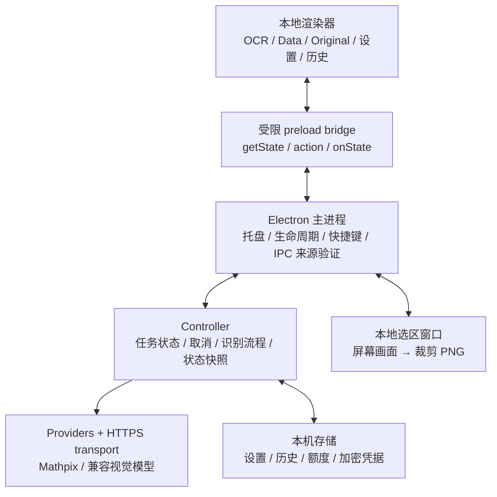

# Windows 版架构

ScreenScribe Windows 是独立的 Electron 桌面项目。目标平台为 Intel / AMD 的 Windows 10 / 11 x64，默认以当前用户权限驻留托盘；没有继承 Mac 应用的签名、Keychain、偏好或历史。UI 延续 716×524 单面板结构，设置和历史在面板内切换。

## 组件关系



| 文件或目录 | 职责 |
|---|---|
| `src/main.cjs` | 托盘、单实例、窗口、快捷键、截图、文件选择、剪贴板、系统加密适配器和 IPC 校验 |
| `src/preload.cjs` | 暴露白名单命令与只读状态订阅，不暴露通用 IPC、文件或网络能力 |
| `src/renderer/` | 原生 HTML/CSS/ES modules 单面板界面和本地 KaTeX 预览 |
| `src/capture/` | 选区覆盖层、受限选区桥接、显示器坐标与像素换算 |
| `src/core/controller.cjs` | 识别编排、请求取消、代次隔离、历史编辑和脱敏状态快照 |
| `src/core/settings.cjs` | 设置白名单、快捷键规范化、字段验证 |
| `src/core/credentials.cjs` | 加密凭据读写、服务地址隔离、密文校验 |
| `src/core/history.cjs` | 最多 50 条 / 25 MB 历史、可选原图、源码编辑与清理 |
| `src/core/credit.cjs` | 整数金额、按账户隔离的本地扣减、五次校准与跨月处理 |
| `src/core/storage.cjs` | 限定文件名、原子 JSON 写入与安全错误信息 |
| `src/services/` | 识别协议、LaTeX 清理和格式包装、有界 HTTPS 请求 |
| `assets/vendor/` | 随包携带的 KaTeX、字体和许可证 |

## 一次识别的数据流

1. 用户通过托盘、面板按钮或快捷键发起框选、导入、粘贴。无后台截图或剪贴板轮询。
2. 主进程获得图片。直接框选会先隐藏面板，为各屏幕创建本地选区覆盖层，按用户选择裁剪。显示器坐标与实际截图尺寸分别测量，不能把逻辑像素直接当作物理像素；屏幕匹配失败时停止，避免上传错误区域。
3. 选定图像以 PNG 留在当前任务内存中，失败后仍可在 Original 对照和手动重试。全屏参考画面只服务本机选区操作，识别请求仅包含裁剪后的 PNG。
4. `Controller` 固定本次服务、模式和模型配置，从主进程凭据库取值。Mathpix 在发送前先持久化一次保守扣减；若计数无法落盘则停止发送。
5. Provider 构造 Mathpix 或兼容视觉模型请求。传输层仅使用 HTTPS，限定响应大小与总时限，支持取消，不跟随重定向，不自动重试计费请求，也不向 UI 透传服务端原始错误正文。
6. 结果清理后作为源码与结构化字段交回。当前结果可预览、编辑和复制，历史仅保存白名单字段；默认不保存原图。历史写入失败时仍保留当前结果供复制，并明确显示错误。
7. 用户取消或更改配置时，控制器通过 AbortController 与请求代次检查阻止旧响应覆盖新任务。界面只接收不含 API Key、原始 App ID 的状态快照。

## 界面与桥接

界面提供 OCR 排版预览、Data 源码编辑、Original 原图对照、四行复制格式、置信度与额度。设置和历史使用同一窗口，可滚动返回识别页。关闭面板会收起至托盘，退出命令才结束进程。

`window.screenScribe` 只提供 `getState()`、`action(name, payload)` 与 `onState(callback)`。渲染器不能调用 `require`、读取文件或直接发起识别请求；主进程核对消息发送者、主 frame 与本地页面 URL。新窗口、任意导航、webview 和网页权限请求被阻止。具体字段与命令以 [CONTRACT.md](CONTRACT.md) 为准。

预览使用随包携带的 KaTeX，`trust: false`，限制展开次数与尺寸，不从 CDN 加载资源。用户和模型返回的源码作为文本处理，不拼接为可执行 HTML。TikZ 仅展示源码与模型给出的图结构，实验性结果需要人工核查；应用不会运行 TeX、安装编译器或执行生成命令。

## 凭据与本机数据

正式 Windows 配置目录为 `%APPDATA%\ScreenScribe-Windows`。Mac 上的演示与 smoke 使用独立临时路径及内存存储，不访问成熟 Mac 版的数据。

Mathpix 保存 App ID 与 API Key，视觉模型按规范化 HTTPS 地址隔离密钥。`CredentialVault` 通过主进程注入的 Electron `safeStorage` 适配器执行加解密，在 Windows 下由 DPAPI 保护，再将密文 Base64 写入 `credentials.json`；没有明文回退。保存成功后清空界面输入，普通设置、历史、额度记录和日志不存 API Key。

DPAPI 与 Windows 登录用户相关，主要防护其他账户或离线直接读取密文的情况；**不能保证防住同一登录用户下的所有进程，也不防已被控制的用户会话**。应用使用凭据时仍需在进程内存中解密。历史源码、可选原图和 Billing 快照以普通本机数据保存，应按这些内容的敏感性管理账户与备份。

历史上限为 50 条和 25 MB。默认新记录仅写源码等元数据，开启原图持久化后才写原图；移除历史原图与清空历史是独立的明确操作。损坏的历史或额度文件会保留并报告，避免静默覆盖。卸载默认保留用户数据。

## 额度估算

官方 Mathpix usage 提供按月图片用量，不直接返回实时账户余额。余额来自用户填写的 Billing 快照：账户余额、待结算用量、图片单价和观察时间。余额、待结算金额精度为 $0.01；单价最多支持 6 位小数。内部以整数微美元及 BigInt 计算，避免浮点舍入误差。

估算先扣除待结算金额并额外预留 $0.01，再将可覆盖图片数向下取整。首次官方用量校准会将已知图片费用向美元分上取整，并为未覆盖的精度差额再预留次数。每次图片请求发送前持久化扣 1 次，失败或手动重试不自动退款。

每完成 5 次 Mathpix 请求触发官方用量查询；未填写 Billing 也保留五次节奏。校准取本地与官方累计消费的较大值，使用官方高水位抵御延迟或回退，不为同一批本机请求再扣一遍，也不提高剩余估算。查询失败时保留本地扣减，可手动刷新；次数、账户状态与五次余数在重启后保留。

额度文件用 App ID 的 SHA-256 派生名称隔离账户，文件名不含原始 App ID。月上限是用户填写的展示参数，不是服务器返回或本机强制的服务限额。跨月或记录异常时隐藏总剩余并要求更新快照。不同图片单价、其他接口及其他设备未同步的消费会降低估算准确性，界面须持续注明“约”与“非实时余额”。

## 构建与验证范围

依赖由 `package-lock.json` 固定；`npm ci` 安装，`npm test` 测试，`npm run smoke` 检查隔离桥接，`npm run dist:win` 使用 Electron Builder 生成 x64 NSIS 安装包：

```text
dist/ScreenScribe-Windows-0.1.0-x64-Setup.exe
```

安装器按当前用户安装，`asInvoker`、`perMachine: false`、`allowElevation: false`，无需管理员权限。当前包未使用代码签名证书，构建命令禁止自动发布。

截至本次实现，已具备 63 项自动测试通过、Mac Electron 隔离 smoke 桥接通过、约 108 MB 的 x64 NSIS 构建产物及 145 项包静态检查通过的证据。静态报告明确保留 `windowsRuntimeVerified=false`。Mac smoke 不截图、不访问真实凭据、不联网，不能证明 Windows 上的 DPAPI、GUI、真实识别、混合缩放多屏截图或安装/卸载运行正确。

后续 Windows 原生验收需在真实 Windows 10 / 11 x64 环境检查：当前用户安装与卸载、托盘和快捷键、各缩放屏幕框选与 Original 对照、DPAPI 凭据重启读回、本人填写凭据后的公开公式识别、取消与错误恢复，以及五次用量校准。当前目录尚未推送远端，也未发布 Windows Release。
